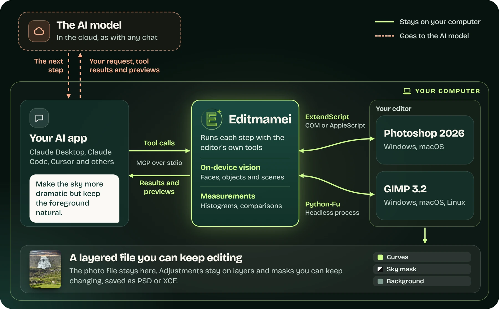

<p align="center">
  <a href="https://editmamei.com"></a>
</p>

<h1 align="center">Editmamei</h1>

<p align="center">
  <strong>Give your AI assistant a real photo editor.</strong>
</p>

<p align="center">
  An MCP server that lets AI apps edit your photos in desktop Photoshop or GIMP. It edits the photo you have instead of generating a new one, and leaves you a layered file you can keep working on.
</p>

<p align="center">
  <a href="https://www.npmjs.com/package/editmamei"></a>
  <a href="https://github.com/editmamei/editmamei/actions/workflows/ci.yml"></a>
  <a href="LICENSE.md"></a>
  <a href="docs/installation.md"></a>
</p>

<p align="center">
  <a href="#install"><strong>Install</strong></a> ·
  <a href="https://editmamei.com">Website</a> ·
  <a href="docs/getting-started.md">Docs</a> ·
  <a href="#editmamei-connect">Editmamei Connect</a> ·
  <a href="https://github.com/editmamei/editmamei/issues">Report a bug</a>
</p>

<p align="center">
  <a href="https://editmamei.com"></a>
  <br>
  <sub>A real run: 73 travel photos, one sentence, graded in Photoshop.</sub>
</p>

<p align="center">
  <sub>Independent project, not affiliated with or endorsed by Adobe Inc.</sub>
</p>

## What you can ask

Once it's connected, talk to your assistant the way you'd brief a retoucher:

- _"Open my vacation photo."_
- _"Make the sky more dramatic but keep the foreground natural."_
- _"Sharpen the eyes, soften the skin, leave everything else alone."_
- _"Isolate the subject onto its own layer with a clean mask."_
- _"Export a 2048px web JPEG."_

Your assistant turns those into tool calls, checks the result with previews and measurements, and iterates.

## Install

**Claude Desktop, no terminal**

1. Download [`editmamei.mcpb`](https://github.com/editmamei/editmamei/releases/latest/download/editmamei.mcpb).
2. In Claude Desktop, go to **Settings → Desktop app → Manage** (next to Extensions) **→ Advanced settings → Install Extension…** and choose the downloaded file.
3. Restart Claude Desktop, then ask it: _"Is Photoshop connected?"_

This route doesn't need Node.js, because Claude Desktop ships its own runtime. The [install guide](docs/installation.md#one-click-install-claude-desktop) covers older versions of the app and updates.

**Claude Code, Cursor, and other MCP apps**

```bash
npm install -g editmamei
editmamei install   # registers with Claude Desktop, Cursor, Claude Code
editmamei status    # shows which AI apps it's registered with
```

Then restart your AI app and ask it: _"Is Photoshop connected?"_ For anything `editmamei install` doesn't detect, see [docs/clients.md](docs/clients.md).

**Requirements**

| | |
| --- | --- |
| **Editor** | Adobe Photoshop 2026 (v27.x) on Windows 10/11 or macOS 13+, or GIMP 3.2 on Windows, macOS, or Linux |
| **AI app** | Any app that can run a local MCP server. Editmamei ships no model of its own, so every edit spends that app's tokens. |
| **Node.js** | 22+, for the npm route only |

## Editmamei Connect

Want to edit from a browser or your phone, or don't have Photoshop or GIMP on this computer? [Editmamei Connect](https://editmamei.com/connect) is the hosted version. Add it to Claude, ChatGPT, or another AI app as a connector, send a photo, and get it back edited. There's nothing to install, and it's free to start.

Connect is a separate product, and its source isn't in this repository. It edits on Editmamei's server instead of on your computer, so your photo is uploaded, and uploads are deleted after 24 hours.

## How it works

<p align="center">
  
</p>

Your AI app decides each step and calls Editmamei's tools. Editmamei carries the step out in your editor and reports back with structured results and, when your AI needs to look, a small preview. Your AI reads those and decides what to do next.

- **Real edits.** Photoshop or GIMP does the pixel work with its own engine, so nothing is redrawn.
- **Reversible.** Adjustments land as adjustment layers, and destructive pixel operations run on an automatic duplicate.
- **Checked, not assumed.** Histograms, region comparisons, and selection previews let your AI measure its own work.
- **On-device vision.** Face, object, and scene detection run locally on bundled ONNX models, so your AI can target "the person on the left" without a cloud vision call.
- **Only verified tools ship.** A new tool stays out of the tool list until it has passed live sessions against real Photoshop or GIMP.

**112 tools:** 83 for Photoshop (62 Community, 21 Pro) and 29 for GIMP (all Community). The full list is in [docs/tools.md](docs/tools.md).

### GIMP

When GIMP 3.2 is detected on your machine, a `gimp_*` tool set registers next to the `ps_*` one, for when you ask for GIMP or Photoshop isn't available. Edits happen in a background `gimp-console` process with no visible window, and you follow along through previews in the conversation. GIMP doesn't yet cover heal/clone or AI subject and sky selection. Details and troubleshooting, including Linux, are in [docs/gimp.md](docs/gimp.md).

## Free and Pro

| | Community (free) | Pro |
| --- | :---: | :---: |
| Documents, layers, masks, type, filters, and retouching | ✓ | ✓ |
| Non-destructive adjustments | ✓ | ✓ |
| AI Select Subject and Select Sky | ✓ | ✓ |
| On-device perception | ✓ | ✓ |
| Previews, histograms, and comparisons | ✓ | ✓ |
| GIMP tools | ✓ | ✓ |
| Camera Raw as a re-editable filter, and raw files developed before they open | | ✓ |
| Folder batch | | ✓ |
| Reproducible templates | | ✓ |
| Warp, named-object masks, and precision placement | | ✓ |
| Subject-instance and face-mesh targeting | | ✓ |
| Photoshop Actions and the scripting escape hatch | | ✓ |

Pro is a Photoshop-only upgrade and adds nothing to the GIMP tools. The split is detailed in [pro-features.md](docs/pro-features.md), and pricing is at [editmamei.com/desktop/pricing](https://editmamei.com/desktop/pricing).

This repository holds the Community source. Pro is a separately licensed module and its source is not published here. Community never imports it, so this tree builds and runs on its own.

## Privacy

Editmamei runs on your computer and edits in your desktop editor. No image content or file paths are sent to Editmamei's servers.

| What | Where it goes | Setting |
| --- | --- | --- |
| Your full-size photo | Stays on your computer | |
| Small previews | Your AI app's model provider, the same as dropping a photo into a chat | `privacy.send_previews_to_llm` (on) |
| Content-free usage telemetry | Editmamei | `telemetry.usage` (on) |
| Sanitized error details | Editmamei, only if you opt in | `telemetry.diagnostics` (off) |
| Update check, with no identifiers | The npm registry | `update_check` (on) |

Change any of these with `editmamei config set <setting> false` (or `true`). Pro also checks its license and looks for module updates. Photoshop's own Select Subject and Select Sky can use Adobe's cloud, depending on Photoshop's Image Processing preference.

Every field is documented in [privacy.md](docs/privacy.md), including [your rights, and the legal basis](docs/privacy.md#your-rights-and-the-legal-basis). npm releases are published from this repository with signed provenance, so you can check the package against this source.

## For developers

Editmamei is a stdio MCP server. In any MCP client, add a server that runs `npx -y editmamei`. The [MCP reference](docs/mcp-reference.md) covers client config, architecture, the MCP surface, settings and environment variables, and each network request the server makes.

The discovery chain is `ps_ping` (liveness), then `ps_overview` (the working method and capability map), then `tools/list` (the full schema-typed inventory). Every tool declares an `outputSchema` and returns typed JSON.

### Build from source

```bash
git clone https://github.com/editmamei/editmamei.git
cd editmamei
npm install
npm run build
npm test
```

You need Node.js 22+ and Go 1.21+. The build compiles the `editmamei-core` binary that generates Photoshop scripts; it needs Go 1.27, which Go fetches for you from 1.21 on. The build warns instead of failing when Go is missing, so you can still run the test suite. Set `EDITMAMEI_CORE_BIN` to a prebuilt binary if you would rather not install Go.

The test suite runs without Photoshop. It verifies the ExtendScript Editmamei generates, never that Photoshop accepted it, so live verification against a real Photoshop is a separate step.

Contributions are welcome. [CONTRIBUTING.md](CONTRIBUTING.md) covers the CLA, the branch and pull-request flow, and what to include in a bug report.

## Documentation

| Guide | What's in it |
| --- | --- |
| [Installation](docs/installation.md) | Every install route, updates, and Photoshop detection |
| [Getting started](docs/getting-started.md) | Your first session and how to get good results |
| [AI apps](docs/clients.md) | Setup for each client, and known limits |
| [Tools](docs/tools.md) | Every tool, by group and edition |
| [GIMP](docs/gimp.md) | Requirements, coverage, and troubleshooting |
| [Pro features](docs/pro-features.md) | What Pro adds, and how to activate it |
| [MCP reference](docs/mcp-reference.md) | Architecture, settings, and network requests |
| [FAQ](docs/faq.md) | Common questions |
| [Troubleshooting](docs/troubleshooting.md) | Fixes for common problems |
| [Roadmap](docs/roadmap.md) | What's planned |

**Found a bug or want a feature?** Use [the issue tracker](https://github.com/editmamei/editmamei/issues). If something's broken, ask your assistant to "report a problem" (or run `editmamei report`) to drop an anonymized diagnostic bundle in your Downloads folder, then attach it to the issue. For security issues, see [SECURITY.md](SECURITY.md) and don't file them publicly.

## License

Editmamei CE is [Fair Source](https://fair.io) software under the [Functional Source License, v1.1, MIT Future License](LICENSE.md) (FSL-1.1-MIT).

You can read, run, modify, and redistribute the code for almost anything: commercial photo editing, internal tools, education, research, security review. The one thing the license holds back, for two years per release, is offering the code to others in a commercial product or service that competes with Editmamei CE or Pro. If you redistribute the code, keep the license and copyright notices with it. Two years after each version ships, that version automatically becomes available under plain [MIT](LICENSE.md).

This section is a plain-English summary. The [LICENSE](LICENSE.md) file is the license; where they differ, the LICENSE file controls. Editmamei is not open source under the OSI definition, and we don't call it that. It is source-available, with the full CE stack developed in the open.

Editmamei Pro is a separate, commercially licensed module; its source is not published. Third-party dependencies keep their own licenses, listed in [NOTICES.md](NOTICES.md).
